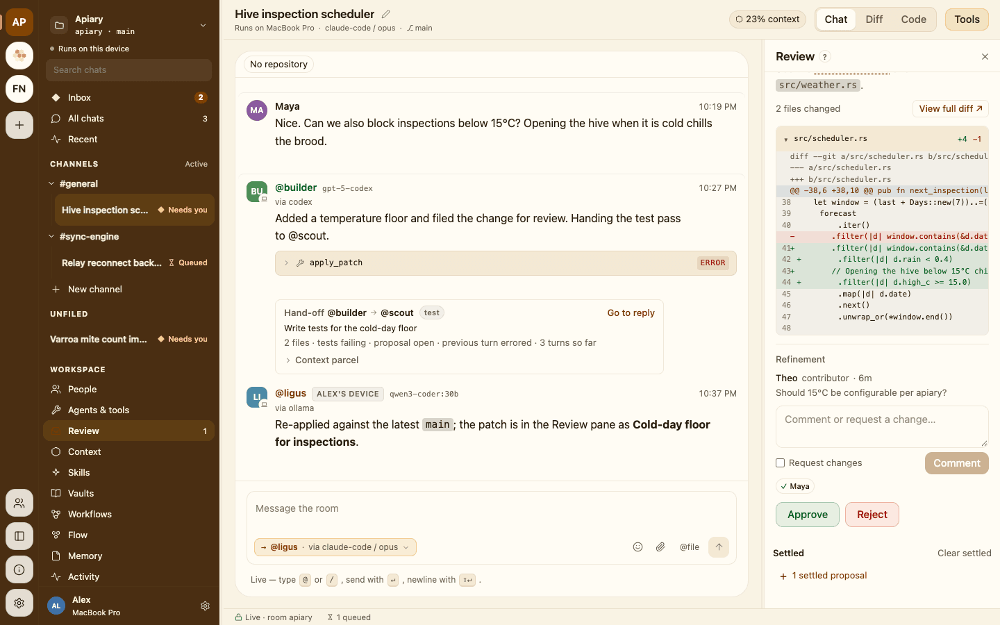

<div align="center">


# Langstroth

**Open source, self-hostable, end-to-end encrypted infrastructure for people working with AI agents.**

[Website](https://langstroth.ai) · [Docs](https://docs.langstroth.ai) · [Download Ligus](https://langstroth.ai/ligus/download)

</div>

<picture>
  <source media="(prefers-color-scheme: dark)" srcset="images/ligus-desktop-dark.png">
  
</picture>

Langstroth is a platform you run yourself. Its client apps are called **Ligus**
(short for *ligustica*, the Italian honeybee): the desktop app, `lt` in the
terminal and the phone app. In a Ligus workspace you, your teammates and your
coding agents share one transcript and one working tree.

- **Agents propose, people decide.** A change arrives as a proposal with its
  diff; people vote, approve and apply it.
- **End-to-end encrypted, self-hostable.** Each device keeps a signed event
  log; the relay only ever sees ciphertext, and you can run it yourself.
- **Sandboxed by default.** Every agent turn runs in an OS sandbox, writing
  only to its chat's worktree.

## Projects

| Repository | What it is |
| --- | --- |
| [**ligus**](https://github.com/langstroth-ai/ligus) | The Ligus desktop app (macOS, Windows, Linux) and the `ligus` CLI: sync a workspace, run agents headless on a box, host the phone app with `ligus serve` |
| [**ligus-term**](https://github.com/langstroth-ai/ligus-term) | `lt`, a terminal app for multi-agent orchestration on a local or Kubernetes deployment |
| [**langstroth-relay**](https://github.com/langstroth-ai/langstroth-relay) | The relay: a content-blind sync and push relay you can self-host, or use the community relay at `relay.langstroth.ai` |
| [**homebrew-ligus**](https://github.com/langstroth-ai/homebrew-ligus) | Homebrew tap for the desktop app, the `ligus` CLI and `lt` |

## Install

```sh
brew install --cask langstroth-ai/ligus/ligus-app   # desktop app (macOS)
brew install langstroth-ai/ligus/ligus             # CLI
brew install langstroth-ai/ligus/lt                # terminal app
```

Installers for every platform are on the [releases page](https://github.com/langstroth-ai/ligus/releases/latest).

## Get in touch

- Questions and ideas: GitHub Discussions on the [ligus repository](https://github.com/langstroth-ai/ligus/discussions)
- Bugs: [issues](https://github.com/langstroth-ai/ligus/issues) on the repository they belong to
- Security reports: the repository's **Security** tab ("Report a vulnerability")
- Anything else: [Discussions](https://github.com/langstroth-ai/ligus/discussions)
